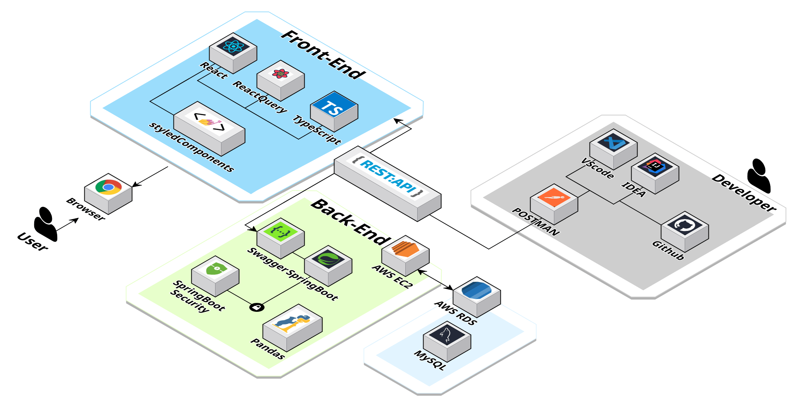

# RedPenLMS

> 사용자가 원하는 직무를 저장하여 교과목을 추천하고, 수강 신청한 교과목의 학습 목표를 토대로 사설 강의를 추천해주는 웹 서비스입니다.


## 📖 Description

기존의 LMS(학습 관리 시스템)는 주로 커뮤니티와 동영상 강의를 제공하는 데 그쳤습니다. 학생들이 깊이 있는 학습이나 추가적인 학습을 원할 때, 필요한 자료나 강의를 찾는 데 불편함이 있었습니다.

학생들이 원하는 직무를 선택하고, 그에 맞는 교과목 추천을 받을 수 있는 시스템을 만들어, 단순한 LMS를 넘어서는 개인화된 학습 경험을 제공하는 것이 목표였습니다.

## ⭐ Main Feature

- 소프트웨어학부 전용 LMS  + AI **설계**
  - 학생의 희망 진로/직무 **선택**
  - 직무 별 교과목 강의 **추천**
  - 교과목 관련 인프런 강의 **추천**
- 주차별 학습 계획 및 성과 **확인**
--- 
### **추가 예정 기능**
- 교과목에 대한 강의평(후기) **제공**
- 전공도서 **중고거래**

---
<br>

## 🔨 Server Architecture



---
<br>

### ERD Diagram


## 🔧 Stack
- **Language**: Java 17
- **Framework**: Spring Boot 3.3.3
- **Libraries**:
  - Spring Web – REST API 개발 
  - Spring Security – 인증 및 인가 처리 
  - Spring Data JPA – ORM 기반 데이터베이스 연동 
  - Validation (Jakarta, Hibernate) – 사용자 입력 검증 
  - Lombok – 코드 간결화 (Getter, Setter, Builder 등)
  - Springdoc OpenAPI (Swagger) – API 문서 자동화
- **Database**: MySQL
- **Deploy**:
  - 미구현


## :open_file_folder: Project Structure

```markdown
src
├─main
│  ├─java
│  │  └─com
│  │      └─project
│  │          └─LMS_plus
│  │              ├─config
│  │              ├─controller
│  │              ├─dto
│  │              │  └─schoolcourse
│  │              ├─entity
│  │              ├─py_recommendation
│  │              ├─repository
│  │              ├─security
│  │              └─service
│  └─resources
│      └─csv
└─test


```

## 🤝 Collaboration
- **GitHub 브랜치 전략**을 활용하여 효율적인 협업

### 💬 **의사소통 및 협업 도구**
- **기획 아이디어 브레인스토밍**을 통해 기능 확정
- **Discord**: 기능 구현 상태 확인 및 이슈 공유
- **Notion**: 문서화 및 일정 관리

## 👨‍💻 Role & Contribution
**백승일**
* 단어 유사도 기반 추천 알고리즘(Cosine Similarity) 구현 
* 강의 목록 조회 및 필터링 기능 개발 
* 사용자 정보 저장 및 프로필 시스템 설계

**이창환**
* 세션 기반 로그인 시스템 구현 
* 강의 목록 자동 크롤링 로직 개발
* 
### **Etc**
- 일정은 유동적으로 조정하였음.

## 👨‍👩‍👧‍👦 Developer
*  **백승일**
*  **이창환**
